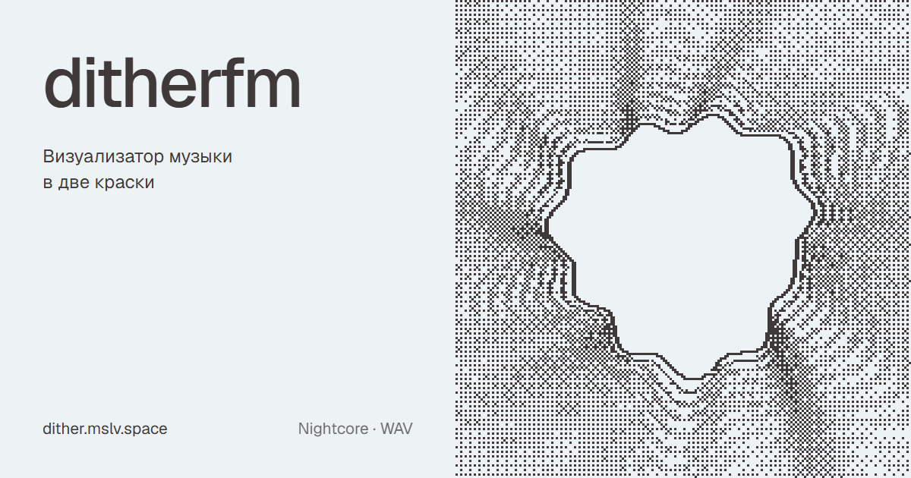

# ditherfm

https://dither.mslv.space

Визуализатор музыки в духе MilkDrop и projectM, нарисованный дизерингом в две краски. Перетащите на страницу mp3, включите найткор и смотрите. Файлы никуда не загружаются: звук обрабатывается и рисуется прямо в браузере.



## Что умеет

- **Найткор.** Скорость и тон меняются вместе, как в настоящем найткоре. Режимы Оригинал, Nightcore (×1.25), Hyper (×1.4), Daycore (×0.8 с реверберацией) и ручная настройка: скорость 0.5–2×, подъём баса до 12 дБ, реверб. Лимитер на выходе не даёт басу клиппировать.
- **Визуализация как в MilkDrop.** Каждый кадр — прошлый кадр, пропущенный через поле зума, вращения и warp-искажений, с затуханием; поверх рисуется волна или спектр, пульсирующие фигуры и рамка. Семь режимов волны: круг, осциллограф, стерео XY, две линии, спектр, спираль, радиальный спектр.
- **Пресеты.** Пятнадцать ручных и бесконечно много сгенерированных из seed. Пресет меняется на сильной доле, параметры плавно перетекают, а картинка продолжается из старого пресета в новый. Замок оставляет текущий.
- **Дизеринг.** Bayer 2/4/8, blue noise, IGN, растр точками и линиями, порог — прямо в шейдере, без мерцания в движении. Размер пикселя от 1 до 8.
- **Палитры.** Восемь двухцветных пар из [bitmap](https://bitmap.mslv.space) и свои цвета.
- **Плейлист.** Несколько файлов, переход к следующему треку, повтор.
- **Экспорт в WAV.** Найткор-версия текущего трека, отрендеренная через ту же цепочку, что и при прослушивании.
- **Во весь экран**, Media Session (клавиши мультимедиа), интерфейс на русском и английском, настройки запоминаются.

Горячие клавиши: пробел — пауза, ← → — перемотка, ↑ ↓ — трек, N — следующий пресет, R — случайный, L — замок, F — во весь экран.

Нужен браузер с WebGL2. Звук со стриминговых сервисов (Spotify и др.) сайтам недоступен, поэтому работают только файлы.

## Запуск

Сборка не нужна: это статический сайт на ES-модулях без зависимостей.

```sh
npx serve .
```

Проверки без браузера (полосы и доли, найткор-настройки, WAV, плейлист, пресеты, переходы):

```sh
npm test
```

## Устройство

| Файл | Что делает |
| --- | --- |
| `audio/engine.js` | воспроизведение: скорость без коррекции тона → полка басов → реверб → лимитер |
| `audio/features.js` | bass / mid / treb относительно среднего, сглаженные версии, доли, волна, спектр |
| `audio/playlist.js` | очередь треков |
| `audio/wav.js` | офлайн-рендер трека и WAV-энкодер |
| `viz/gl.js` | обёртки WebGL2: программы, буферы, ping-pong |
| `viz/pipeline.js` | кадр: warp обратной связи → волна → дизеринг в две краски |
| `viz/dither.js` | пороги дизеринга на GLSL |
| `viz/presets.js` | ручные пресеты |
| `viz/random.js` | пресет из seed |
| `viz/director.js` | смена пресетов и переходы |
| `gen/rng.js`, `gen/bluenoise.js` | seed-генератор и карта blue noise из bitmap |
| `app.js`, `i18n.js` | интерфейс и переводы |
| `tools/og.html` | страница, с которой снимается `og.png` |

### Свой пресет

Пресет — объект в `viz/presets.js`: базовые параметры (`zoom`, `rot`, `warp`, `decay`, `waveMode`, `shapeSides`… — полный список в `DEFAULT_PARAMS` в `viz/pipeline.js`), функция `frame(p, a, t, s)`, которая каждый кадр двигает параметры от музыки (`a.bass`, `a.mid_att`, `a.beat`…), и необязательный `warp` — строка GLSL, выполняемая для каждого пикселя, как per-pixel код в MilkDrop:

```js
{
    id: 'ripples', name: 'Ripples',
    base: { decay: 0.96, waveMode: 0 },
    frame(p, a, t) { p.q1 = 0.4 + a.bass_att; },
    warp: 'zoom += 0.035 * q1 * sin(rad * 22.0 - time * 4.0);',
}
```

## Лицензия

[MIT with Attribution](LICENSE) © 2026 oxolegit. При публичном использовании нужна видимая ссылка на этот репозиторий: https://github.com/oxolegit/ditherfm
