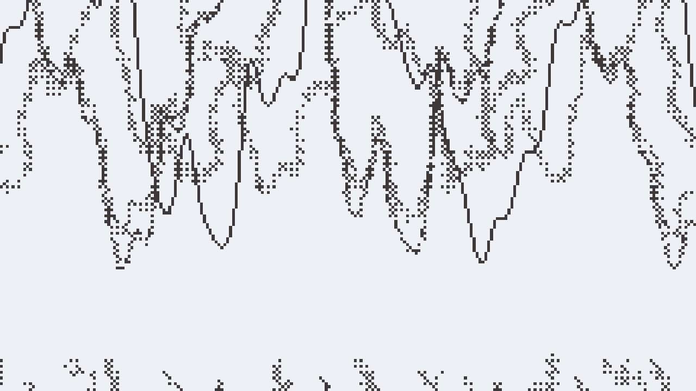
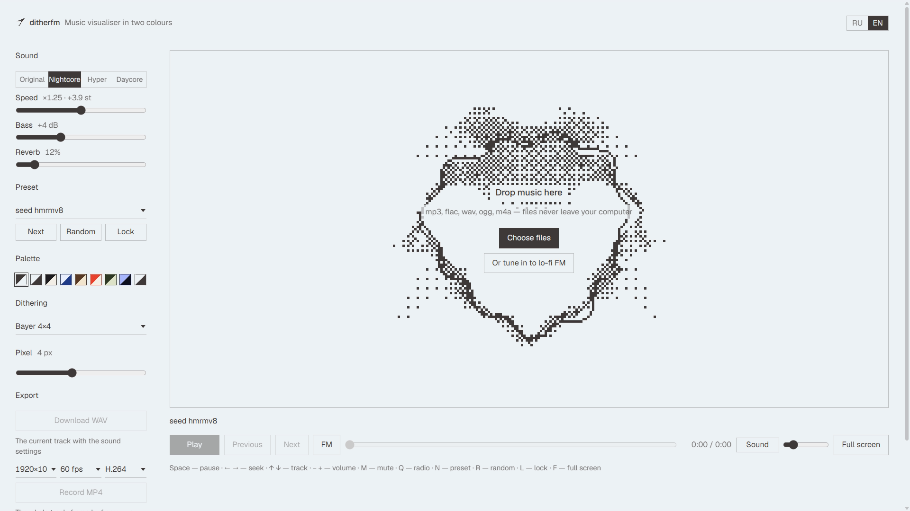

# ditherfm

https://dither.mslv.space

A music visualizer in the spirit of MilkDrop and projectM, drawn with two-color dithering. Drop an mp3 onto the page, turn on nightcore and watch. Files are never uploaded anywhere: the audio is processed and rendered right in the browser.


## Features

- **Nightcore.** Speed and pitch change together, like real nightcore. Modes: Original, Nightcore (×1.25), Hyper (×1.4), Daycore (×0.8 with reverb) and manual: speed 0.5–2×, bass boost up to 12 dB, reverb. A limiter on the output keeps the bass from clipping.
- **MilkDrop-style visuals.** Each frame is the previous frame passed through a zoom, rotation and warp field with decay; a waveform or spectrum, pulsing shapes and a border are drawn on top. Seven wave modes: circle, oscilloscope, stereo XY, two lines, spectrum, spiral, radial spectrum.
- **Presets.** Fifteen hand-made ones and endlessly many generated from a seed. Presets switch on a strong beat, parameters blend smoothly, and the image flows from the old preset into the new one. The lock keeps the current one.
- **Dithering.** Bayer 2/4/8, blue noise, IGN, dot and line halftone, threshold — right in the shader, with no flicker in motion. Pixel size from 1 to 8.
- **Palettes.** Eight two-color pairs from [bitmap](https://bitmap.mslv.space) plus custom colors.
- **Playlist.** Multiple files, advance to the next track, repeat.
- **WAV export.** A nightcore version of the current track, rendered through the same chain used for playback.
- **Video export.** The current track with its visuals, rendered frame by frame: the sound goes through the same chain as the WAV, each frame is drawn from it and encoded with WebCodecs at constant quality (H.264, HEVC or AV1, whatever the browser offers) into MP4. 1920×1080 at 60 fps on a computer and 1080×1920 on a phone by default; the frame rate is steady on any machine. The radio, and browsers without WebCodecs, record live with MediaRecorder instead.
- **Lo-fi FM.** A shared generative radio: songs are written from a seed and synthesised in the browser, and what plays is a function of UTC time, so every listener hears the same bar at the same moment. Bass, reverb and the visuals apply; speed stays at ×1 to keep the air in sync.
- **Volume** and a mute button; the visuals don't depend on volume, and the WAV is saved at full volume.
- **Fullscreen**, Media Session (media keys), interface in Russian and English, settings are remembered.



Hotkeys: Space — pause, ← → — seek, ↑ ↓ — track, − + — volume, M — mute, N — next preset, R — random, L — lock, F — fullscreen.

Requires a browser with WebGL2. Audio from streaming services (Spotify, etc.) isn't accessible to websites, so only files work.

## Running

No build step: it's a static site built on ES modules with no dependencies.

```sh
npx serve .
```



Browser-free checks (bands and beats, nightcore settings, WAV, playlist, presets, transitions):

```sh
npm test
```

## How it works

| File | What it does |
| --- | --- |
| `audio/engine.js` | playback: speed without pitch correction → bass shelf → reverb → limiter |
| `audio/features.js` | bass / mid / treb relative to average, smoothed versions, beats, waveform, spectrum |
| `audio/playlist.js` | track queue |
| `audio/wav.js` | offline track rendering and WAV encoder |
| `audio/lofi.js` | lo-fi FM: songs from a seed, the UTC schedule, synths and the scheduler |
| `viz/gl.js` | WebGL2 wrappers: programs, buffers, ping-pong |
| `viz/pipeline.js` | frame: feedback warp → wave → two-color dithering |
| `viz/dither.js` | dithering thresholds in GLSL |
| `viz/presets.js` | hand-made presets |
| `viz/random.js` | preset from a seed |
| `viz/director.js` | preset switching and transitions |
| `viz/record.js` | video recording: canvas and sound to MP4 / WebM |
| `viz/offline.js` | frame-by-frame video: offline sound, visuals per frame, WebCodecs, MP4 |
| `audio/analysis.js` | what an AnalyserNode would report, computed from a rendered buffer |
| `vendor/mp4-muxer.js` | [mp4-muxer](https://github.com/Vanilagy/mp4-muxer) 5.2.2 by Vanilagy, MIT |
| `gen/rng.js`, `gen/bluenoise.js` | seed generator and blue noise map from bitmap |
| `app.js`, `i18n.js` | interface and translations |
| `tools/og.html` | page used to capture `og.png` |

### Custom preset

A preset is an object in `viz/presets.js`: base parameters (`zoom`, `rot`, `warp`, `decay`, `waveMode`, `shapeSides`… — the full list is in `DEFAULT_PARAMS` in `viz/pipeline.js`), a `frame(p, a, t, s)` function that moves parameters with the music every frame (`a.bass`, `a.mid_att`, `a.beat`…), and an optional `warp` — a GLSL string executed for every pixel, like per-pixel code in MilkDrop:

```js
{
    id: 'ripples', name: 'Ripples',
    base: { decay: 0.96, waveMode: 0 },
    frame(p, a, t) { p.q1 = 0.4 + a.bass_att; },
    warp: 'zoom += 0.035 * q1 * sin(rad * 22.0 - time * 4.0);',
}
```

## License

[MIT with Attribution](LICENSE) © 2026 oxolegit. Public use requires a visible link to this repository: https://github.com/oxolegit/ditherfm
